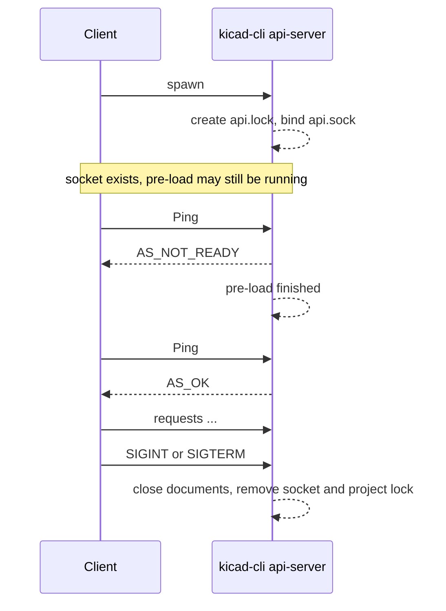

# IPC protocol

Statements are **[live]** (observed against the headless server of build `10.99.0-6860-gbdd2930d2b`) unless marked
**[src]** (read from source at commit `bdd2930d2b`, not executed).

## Summary

Request/reply: a client sends one protobuf `ApiRequest` over an NNG socket and receives one `ApiResponse`. No
server-initiated messages; anything asynchronous is polled.

| Layer | Detail |
|---|---|
| Transport | NNG (nanomsg-next-gen) `REQ`/`REP` over a Unix domain socket, URL `ipc://<path>` |
| Encoding | Protocol Buffers 3; commands and items travel as `google.protobuf.Any` |
| Schema | `api/proto/` in the KiCad source tree, packages `kiapi.common.*`, `kiapi.board.*`, `kiapi.schematic.*` |
| Concurrency | Requests handled one at a time on KiCad's main loop. Two clients connected at once both got replies. |
| Units | Lengths in integer nanometres, angles in degrees, Y axis pointing down |

## Server modes

| | Headless: `kicad-cli api-server` | GUI: `kicad`, `eeschema`, `pcbnew` **[src]** |
|---|---|---|
| Needs a display | No | Yes |
| Enabled by | Running the command | `api.enable_server: true` in `kicad_common.json` |
| Default socket | `/tmp/kicad/api.sock` | Same. Both modes use `api-<pid>.sock` when that path belongs to a live server. |
| Socket override | `--socket <path>` | None |
| Documents | Opened and created by the client | Whatever the user has open |
| `OpenDocument`, `CloseDocument`, `CloseAllDocuments`, `CreateDocument` | Available | `AS_UNIMPLEMENTED` |
| `SaveDocumentAs`, `LoadAllLibraries` | Available | `AS_UNIMPLEMENTED` |
| Selection, view, layer visibility, `RunAction`, interactive move | `AS_UNIMPLEMENTED` | Available |
| Plugins | Not involved | Launched with `KICAD_API_SOCKET` and `KICAD_API_TOKEN` set |

Everything else in [03-command-reference.md](03-command-reference.md) is registered in both modes by the same handler
classes.

## Running the headless server

```sh
KICAD_CONFIG_HOME=<settings-dir> kicad-nightly kicad-cli api-server --socket <dir>/api.sock [file]
```



Startup and shutdown:

- **Readiness.** The server prints `KiCad API server listening at ipc://…` on stdout, but stdout is block-buffered
  when not a terminal: redirected to a file, the file stayed empty all run and got the line only at exit. Wait for
  the socket file, then retry while the reply is `AS_NOT_READY`. With a file to pre-load, `AS_NOT_READY` was
  returned briefly after the socket appeared.
- **Socket directory.** Created if missing. An `api.lock` file is created beside the socket and left behind.
- **Stale socket.** A socket left by a killed server did not block the next start on the same path. The server takes
  the `api.lock` file lock and removes the orphaned socket **[src]**.
- **Clean shutdown.** `SIGINT` and `SIGTERM` both print `Shutting down`, close all documents, and remove the socket
  and the project lock file `~<project>.kicad_pro.lck`.
- **Unclean exit.** After a kill by hangup, the socket and project lock file remained. The next server opened that
  project without complaint.
- **Pre-load argument.** A `.kicad_pro` opens only the project: no schematic or board handler is registered until
  the client opens one. A `.kicad_sch` or `.kicad_pcb` opens that document and its project.

## Envelope

`api/proto/common/envelope.proto`:

```proto
message ApiRequest {
  ApiRequestHeader header = 1;      // kicad_token, client_name
  google.protobuf.Any message = 2;  // the command
}

message ApiResponse {
  ApiResponseHeader header = 1;     // kicad_token
  ApiResponseStatus status = 2;     // status code, error_message
  google.protobuf.Any message = 3;  // the command's response type
}
```

- **Type URL.** `type.googleapis.com/<package>.<Message>`, e.g. `type.googleapis.com/kiapi.common.commands.GetVersion`.
  The server dispatches on the part after the slash.
- **`client_name`.** Free text. Pending commits are stored per `client_name` **[src]**, so all requests of one commit
  must carry the same name.
- **`kicad_token`.** UUID generated per server process, returned in every response header. Empty token: accepted.
  Differing non-empty token: `AS_TOKEN_MISMATCH`. Sending the token back detects a server restart.

## Status codes

| Code | When it was returned |
|---|---|
| `AS_OK` | Success. `message` holds the response type listed in the command reference. |
| `AS_NOT_READY` | Server started, loading not finished. Also: project-level command with no project loaded **[src]**. |
| `AS_BAD_REQUEST` | Envelope or payload (as the named type) not parseable; invalid arguments; document or project specifier not matching what is open. |
| `AS_UNHANDLED` | No handler accepted the request. See below. |
| `AS_UNIMPLEMENTED` | Handler exists but unavailable in this mode, e.g. `RunAction is not available in headless mode`. |
| `AS_TOKEN_MISMATCH` | Non-empty `kicad_token` that is not this server's. |
| `AS_BUSY` | A task is running; only task status and result queries are served **[src]**. |
| `AS_INTERNAL_ERROR` | Failure inside KiCad, e.g. fetching the result of a task that did not complete **[src]**. |
| `AS_TIMEOUT` | Declared; no use found in the handlers **[src]**. |

`AS_UNHANDLED` always carries `no handler available for request of type <type>`, but has two causes:

1. No handler registered for that message type. Editor handlers exist only while a matching document is open.
2. A registered handler declined because its `DocumentSpecifier` has a different document type. Example:
   `GetOpenDocuments` with `DOCTYPE_PCB` while only a schematic is open, or with `DOCTYPE_PROJECT` at any time.

Item-level calls add two layers inside an `AS_OK` response: `ItemRequestStatus` per request (`IRS_OK`,
`IRS_DOCUMENT_NOT_FOUND`, `IRS_FIELD_MASK_INVALID`) and `ItemStatus` per item (`ISC_OK`, `ISC_INVALID_TYPE`,
`ISC_EXISTING`, `ISC_NONEXISTENT`, `ISC_IMMUTABLE`, `ISC_INVALID_DATA`). Check all three. Generated Python:
`ItemRequestStatus` in `common.types.base_types_pb2`, `ItemStatusCode` in `common.commands.editor_commands_pb2`.

## Handlers appear as documents open

Measured by sending every proto message type with an unparseable payload: a registered handler answers
`AS_BAD_REQUEST` without running; an unregistered type answers `AS_UNHANDLED`.

| Server state | Registered commands |
|---|---|
| Nothing open, or project only | 24 |
| Schematic open | 72 |
| Schematic and board open | 133 |
| Plus a symbol open in the library editor | 134 |
| Plus a footprint open | 134 (same commands, now also routed to the footprint) |

The 134 exactly match the source's `registerHandler` calls.

## Documents

`DocumentSpecifier` (`common/types/base_types.proto`) names the target of most commands:

```proto
message DocumentSpecifier {
  DocumentType type = 1;           // DOCTYPE_SCHEMATIC, _SYMBOL, _PCB, _FOOTPRINT, _PROJECT, ...
  oneof identifier {
    LibraryIdentifier lib_id = 2;  // symbol or footprint: library_nickname + entry_name
    SheetPath sheet_path = 3;      // schematic: which sheet
    string board_filename = 4;     // board: "name.kicad_pcb"
  }
  ProjectSpecifier project = 5;    // name + path
}
```

Observed in headless mode:

- **One project per server.** Opening a file from another project fails with
  `cannot open a document from project 'X' because project 'Y' is already open`. Close everything first.
- **At most one schematic and one board.** A second `OpenDocument` of the same type fails with
  `a document of this type is already open`.
- **Library items.** `OpenDocument` with `DOCTYPE_SYMBOL` or `DOCTYPE_FOOTPRINT` takes a `Library:Item` string as
  `path`. One symbol and one footprint were open alongside a schematic and a board; more than one of each not tested.
- **Reuse returned specifiers.** Pass the `DocumentSpecifier` from `OpenDocumentResponse`, `CreateDocument`, or
  `GetOpenDocuments` back unchanged. Hand-built specifiers failed in these cases:
  - `GetSchematicHierarchy` with no `project`: `the requested project  is not open`.
  - `GetTextVariables` with a board specifier: `AS_UNHANDLED`. It requires `type = DOCTYPE_PROJECT` with both
    project name and path.
- **Project path mismatch.** The board handler reports the project path without trailing slash (`/work/demo`), the
  schematic handler with one (`/work/demo/`). Project-level commands compare the path as an exact string and accepted
  only the trailing-slash form. Use the schematic's `project`, or append the slash.
- **Sheets.** `GetSchematicHierarchy` returns the sheet tree with a `SheetPath` per sheet. A schematic specifier with
  a `sheet_path` targets that sheet; without one, `GetItems` returned items of all sheets.
- **Created documents.** `CreateDocument` makes an in-memory schematic or board at the given path, plus a project of
  the same base name. Nothing is on disk until `SaveDocument`, which wrote the `.kicad_sch`, `.kicad_pro`, and
  `.kicad_prl`.
- **Closing discards.** `CloseDocument` on a modified board returned `AS_OK` and dropped the changes. Check
  `GetDocumentModifiedState` first when that matters.

## Items

Items are protobuf messages packed in `Any`: `kiapi.schematic.types.*` for schematics
(`SchematicSymbolInstance`, `SchematicLine`, `Junction`, `LocalLabel`, `SheetSymbol`, …) and
`kiapi.board.types.*` for boards (`FootprintInstance`, `Pad`, `Track`, `Via`, `Zone`, `BoardGraphicShape`, …).

- **Identity.** Every item has a `KIID` (UUID string). Leave `id` empty on create; the response returns the item with
  its assigned id.
- **`ItemHeader`.** Carries the `DocumentSpecifier`. No handler reads its `field_mask`: an `UpdateItems` with a mask
  naming one field still replaced the whole item.
- **Updates replace.** `UpdateItems` deserializes the full message over the existing item. Read, change, send it all
  back. Two consequences: [04-workflows.md](04-workflows.md#behaviors-to-know).
- **Type filter.** `GetItems.types` takes `KiCadObjectType` values (`KOT_SCH_SYMBOL`, `KOT_PCB_TRACE`, …). A type
  invalid for the document fails the whole request: `KOT_SCH_PIN` on a schematic gave
  `none of the requested types are valid for a Schematic object`.
- **Coordinates.** Absolute, nanometres, Y down, both editors. No grid snapping: a symbol placed at 100.0 mm stayed
  there although the schematic connection grid is 1.27 mm. Snap in the client; off-grid pins do not connect to
  on-grid wires.
- **Connections.** A wire connects where its endpoint lands on a pin. Pins on the same point connect without a wire:
  a resistor pin placed on a `GND` symbol's pin joined the GND net, and a `PWR_FLAG` placed on a `GND` pin flagged
  that net with no ERC error.
- **Containers.** `CreateItems.container` names an existing symbol or footprint to add child items to.

## Commits

- Without a commit, each mutating call takes effect immediately.
- `BeginCommit` returns an id; following mutations are staged. `EndCommit` with `CMA_COMMIT` applies them as one
  change with an optional message; `CMA_DROP` discards them. After a drop, three placed symbols were gone.
- A sheet created inside an open commit did not appear in `GetSchematicHierarchy` until the commit ended.
- No undo or redo command. Headless `RunAction` is unavailable, so a committed change can only be reversed by
  another edit, `RevertDocument`, or closing without saving.

## Tasks

ERC, DRC, and zone fill can run as tasks (`common/tasks.proto`, `schematic/schematic_tasks.proto`,
`board/board_tasks.proto`):

1. `StartErcTask`, `StartDrcTask`, or `StartRefillZonesTask` returns a `TaskToken` at once.
2. Poll `GetTaskStatus(token)` until the state leaves `TS_RUNNING` (`TS_COMPLETED`, `TS_FAILED`, `TS_CANCELLED`).
3. Fetch `GetErcTaskResult(token)` or `GetDrcTaskResult(token)`: markers with type, position, item ids, severity,
   and description, plus ignored and excluded counts.

One task runs at a time; other commands get `AS_BUSY` until it ends **[src]**. On the small test designs, tasks had
completed before the first status poll. `RefillZones` is the blocking zone-fill alternative and ran synchronously.

## Export jobs

`RunSchematicJobExport*` and `RunBoardJobExport*` take a `RunJobSettings { document, output_path }` plus
format-specific options and return `RunJobResponse { status, output_path[], message }`.

- Missing output directories were created.
- Response `output_path` listed the written files for most jobs. Render and 3D jobs returned `JS_SUCCESS` with an
  empty list although the files were written.

## Libraries

- `GetLibraryStatuses` lists every library-table row with its load state. Works with nothing open but needs `scope`
  (`LTS_GLOBAL`, `LTS_PROJECT`, or `LTS_BOTH`); without it: `AS_BAD_REQUEST: unknown library table scope`.
- **Rows report `LLS_INVALID` until their load starts**, not only when broken. Right after start all 223 symbol rows
  were `LLS_INVALID`. `LoadAllLibraries` starts a background load. Poll `GetLibraryStatuses` until needed rows are
  `LLS_LOADED` (took 1–2 s); only `LLS_ERROR` means failure.
- `PlaceSymbolFromLibrary` does not wait for that load. Before it finished, placement failed with
  `symbol 'Timer:NE555P' not found`.
- `GetLibraryItems` (by `type` and `nickname`) lists the `LibraryIdentifier`s in named libraries: 537 symbols in
  `Device`, 67 footprints in `Resistor_SMD`. `GetItemsFromLibrary` returns full definitions (`SchematicSymbol`,
  `Footprint`), **not in request order**; match on `id`. Both handlers are registered with nothing open but
  answered `AS_UNHANDLED` until a document was open. Worked with a schematic open; project-only not tested.
- Library tables cannot be read or edited via the API: `GetLibraryTable`, `AddLibraryTableEntry`,
  `UpdateLibraryTableEntry`, `DeleteLibraryTableEntry`, and `SearchLibraries` are declared in the protos but have no
  handler. Tables are the `sym-lib-table` and `fp-lib-table` files in the settings and project directories.

## Logging

- `WXTRACE=KICAD_API` produced no output from `kicad-cli` in this release build.
- `EnableAPILogging=1` in the settings directory's `kicad_advanced` file writes each request and response as text to
  `api.log` in KiCad's logs directory **[src]**.

## GUI plugins

**[src]** In GUI mode KiCad can launch IPC plugins from toolbar buttons: the route for interactive use, not involved
in headless operation.

- A plugin is a directory with `plugin.json`, validated against `share/kicad/schemas/api.v1.schema.json`.
- Required keys: `identifier`, `name`, `description`, `runtime`, `actions`.
- `runtime.type` is `python` or `exec`. For `python`, KiCad creates a virtual environment per plugin and installs
  the plugin's `requirements.txt`.
- Each action has `identifier`, `name`, `description`, `entrypoint`, and optional `args`, `show-button`,
  `icons-light`, `icons-dark`, and `scopes` (`pcb`, `schematic`, `footprint`, `symbol`, `project_manager`,
  `footprint_wizard`).
- KiCad scans the stock plugins directory, the third-party (PCM) directory, and the user plugins directory
  (`~/.local/share/kicad/10.99/plugins` here, as reported by `GetPaths`).
- The entrypoint is started with `KICAD_API_SOCKET` and `KICAD_API_TOKEN` in its environment.

## Client bindings

The AppImage ships no `.proto` files and no client library. Two options:

### Generate bindings from the matching source

Verified from an empty directory; `examples/minimal_client.py` ran against the result.

```sh
SHA=$(kicad-nightly kicad-cli version --format commit)

git init -q kicad-src && cd kicad-src
git remote add origin https://github.com/KiCad/kicad-source-mirror.git
git sparse-checkout set --no-cone '/api/'
git fetch -q --depth 1 --filter=blob:none origin "$SHA" && git checkout -q FETCH_HEAD
cd ..

uv venv --python 3.12 .venv
uv pip install --python .venv/bin/python pynng protobuf grpcio-tools
mkdir gen
.venv/bin/python -m grpc_tools.protoc -I kicad-src/api/proto \
    --python_out=gen --pyi_out=gen $(find kicad-src/api/proto -name '*.proto')
```

- 27 proto files; versions used: `pynng` 0.9.0, `protobuf` 7.36.2, `grpcio-tools` 1.85.3.
- Generated modules sit in top-level packages `common`, `board`, and `schematic`, because the protos import each
  other by those paths. They need their own directory on `sys.path`.
- Module paths follow `.proto` file paths, not protobuf packages:
  - `kiapi.common.tasks` is `common.tasks_pb2`.
  - `RuleSeverity` and `ItemRequestStatus` are in `common.types.base_types_pb2`, not `enums_pb2`.
- To unpack any response by type URL via `symbol_database.Default()`, first import every generated `*_pb2` module
  and `google.protobuf.empty_pb2`. Otherwise commands returning `Empty` fail with
  `Couldn't find message google.protobuf.Empty`.
- Protos change between nightlies. Regenerate whenever the AppImage is updated.

### `kicad-python` (`kipy`)

The official client, <https://gitlab.com/kicad/code/kicad-python>. Not tested against this build.

- PyPI has 0.8.0. The `main` branch is `0.9.0.dev0`.
- `main` contains `kipy/schematic.py`, `schematic_types.py`, `schematic_jobs.py`, and `kipy/server.py`, which starts
  and manages `kicad-cli api-server`.
- It builds bindings from a KiCad submodule pinned to a specific commit (`0ef63a79` on 2026-11-21), so it can lag or
  lead a given nightly.
- It depends on `protobuf >=5.29.6,<6` and `pynng >=0.9.0,<0.10.0`.
