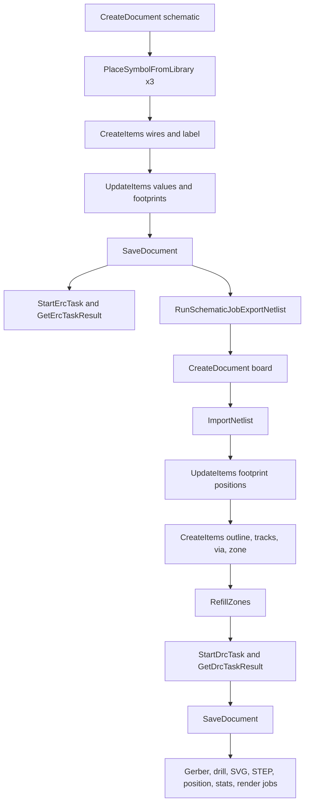

# Workflows and behaviors

Everything here ran on the headless server of build `10.99.0-6860-gbdd2930d2b`, no display, unless marked
**[src]**. Test designs: the bundled `pic_programmer` demo (2 sheets, 124 symbols, 63 footprints, 370 tracks) and a
three-part board built from scratch via the API. The schematic recipes are packaged as a reusable builder in
[`schematics/kicad_sch_ipc.py`](../schematics/kicad_sch_ipc.py): grid snapping, pin lookup, library-load waiting,
netlist check, ERC, plots, cropping ([05](05-cropping-schematic-plots.md)). It built five designs of 7 to 100
components each (power and flag symbols not counted). It runs on the runtime from
[`engine/kicad-agent doctor`](../engine/kicad_agent/bootstrap.py): bindings, venv, isolated config, locked server.

Snippets assume `call(request)`, which wraps the request in an `ApiRequest`, checks status, and returns the unpacked
response (see [examples/minimal_client.py](examples/minimal_client.py)); `pack(msg)`, which wraps a message in
`google.protobuf.Any`; and these imports from the generated bindings:

```python
from common.commands import editor_commands_pb2 as editor, project_commands_pb2 as project
from common.types import base_types_pb2 as types, enums_pb2 as enums, jobs_pb2 as jobs
from schematic import schematic_commands_pb2 as sch_cmd, schematic_types_pb2 as sch
from schematic import schematic_tasks_pb2 as sch_tasks, schematic_jobs_pb2 as sch_jobs
from board import board_commands_pb2 as brd_cmd, board_types_pb2 as brd
from board import board_tasks_pb2 as brd_tasks, board_jobs_pb2 as brd_jobs

def mm(x, y):
    return types.Vector2(x_nm=round(x * 1e6), y_nm=round(y * 1e6))
```

## The pipeline that was run



Result: a project (`.kicad_pro`, `.kicad_sch`, `.kicad_pcb`) that the AppImage's own `kicad-cli sch erc` and
`kicad-cli pcb drc` loaded and checked. API and CLI DRC reported the same four violations, all from a test track
drawn straight across another net's pad.

## Schematic

### Create and address the sheet

```python
doc = call(project.CreateDocument(type=types.DOCTYPE_SCHEMATIC, path="/abs/blinky.kicad_sch")).document
root = call(sch_cmd.GetSchematicHierarchy(document=doc)).top_level_sheets[0].path
sheet = types.DocumentSpecifier(type=types.DOCTYPE_SCHEMATIC, sheet_path=root, project=doc.project)
header = types.ItemHeader(document=sheet)
```

### Place symbols

Wait for the symbol libraries first: placement fails with `symbol … not found` while they load
([02](02-ipc-protocol.md#libraries)).

```python
GRID = 1.27  # mm; connection points must land on this grid, the API does not snap

request = sch_cmd.PlaceSymbolFromLibrary(
    header=header,
    lib_id=types.LibraryIdentifier(library_nickname="Device", entry_name="R"),
    position=mm(80 * GRID, 40 * GRID),
    reference="R1",
)
symbol = sch.SchematicSymbolInstance()
call(request).item.Unpack(symbol)
```

The returned instance carries the full library definition. Pins are `SchematicPin` entries in
`symbol.definition.items`, positioned relative to the symbol origin, Y down:

| Symbol | Pin | Offset (grid units) |
|---|---|---|
| `Device:R` | 1 | (0, −3) |
| `Device:R` | 2 | (0, +3) |
| `Device:LED` | 1 (K) | (−3, 0) |
| `Device:LED` | 2 (A) | (+3, 0) |
| `Connector_Generic:Conn_01x02` | 1 | (−4, 0) |
| `Connector_Generic:Conn_01x02` | 2 | (−4, +2) |

For pin offsets of any symbol, run `"$KICAD_AGENT_PYTHON" schematics/kicad_sch_ipc.py pins Lib:Symbol …` (after
`eval "$(python3 engine/kicad-agent env)"`).

Connection point = `symbol.position + T(pin.position)`. `orientation` rotates counter-clockwise on screen. In grid
units, Y down:

| `orientation` | T(x, y) | Verified by |
|---|---|---|
| `SSO_0` | (x, y) | every design |
| `SSO_90` | (y, −x) | NE555 LED, buzzer R1, AM-radio capacitors |
| `SSO_180` | (−x, −y) | `sram16` PMOS pull-ups, AM-radio J1 and D1 |
| `SSO_270` | (−y, x) | `sram16` access transistors, buzzer D1 |

Each design's netlist matched the intended connectivity, confirming the mapping. Mirroring (`transform.mirror_x`,
`mirror_y` on an update) not tested.

Multi-unit symbols: `PlaceSymbolFromLibrary` with `unit` set places one unit. `NJM4556A` units 1, 2, 3 placed with
the same `reference` gave `U1A`, `U1B`, `U1C` (the power unit) of one `U1`. In `definition.items` a pin child's
`unit` is its unit; `0` means every unit.

### Wires, labels, junctions

```python
def wire(a, b):
    return pack(sch.SchematicLine(start=mm(*a), end=mm(*b), type=sch.SLT_WIRE))

label = sch.LocalLabel(position=mm(86 * GRID, 48 * GRID))
label.text.text = "LED_A"

commit = call(editor.BeginCommit(header=header))
result = call(editor.CreateItems(header=header, items=[wire(p1, p2), wire(p2, p3), pack(label)]))
call(editor.EndCommit(id=commit.id, action=editor.CMA_COMMIT, message="wire up", header=header))
```

Each segment is its own `SchematicLine`. Check `result.status` and every `result.created_items[i].status.code`.
Also created successfully: `GlobalLabel`, `HierarchicalLabel`, `DirectiveLabel`, `NoConnectMarker`, `Junction`.

### Change symbol fields

```python
items = call(editor.GetItems(header=header, types=[enums.KOT_SCH_SYMBOL])).items
symbol = sch.SchematicSymbolInstance(); items[0].Unpack(symbol)

symbol.value_field.text.text = "330"
symbol.footprint_field.text.text = "Resistor_SMD:R_0603_1608Metric"
symbol.ClearField("definition")          # see "Behaviors to know"
call(editor.UpdateItems(header=header, items=[pack(symbol)]))
```

### Connectivity

`GetSchematicNetlist` returns, per net, the KIIDs of the items on it. Pin KIIDs match the `id` of the `SchematicPin`
entries inside each symbol's `definition.items`, which gives a net → `reference.pin` map:

```python
pins = {}
for any_item in call(editor.GetItems(header=header, types=[enums.KOT_SCH_SYMBOL])).items:
    symbol = sch.SchematicSymbolInstance(); any_item.Unpack(symbol)
    for child in symbol.definition.items:
        if child.item.Is(sch.SchematicPin.DESCRIPTOR):
            pin = sch.SchematicPin(); child.item.Unpack(pin)
            pins[pin.id.value] = f"{symbol.reference_field.text.text}.{pin.number}"

netlist = call(sch_cmd.GetSchematicNetlist(document=sheet, types=[enums.KOT_SCH_PIN]))
for net in netlist.nets:
    print(net.name, [pins[i.value] for s in net.sheets for i in s.items])
# /LED_A ['D1.2', 'R1.2']
# Net-(D1-K) ['J1.2', 'D1.1']
# Net-(J1-Pin_1) ['R1.1', 'J1.1']
```

A pin with a `NoConnectMarker` still appears in the netlist, as a single-pin net named like
`unconnected-(U1-GAIN-Pad1)`.

### Hierarchical sheets

```python
child = sch.SheetSymbol(position=mm(120 * GRID, 20 * GRID), size=mm(20 * GRID, 10 * GRID))
child.name_field.text.text = "child"
child.filename_field.text.text = "child.kicad_sch"
call(editor.CreateItems(header=header, items=[pack(child)]))
```

Afterwards `GetSchematicHierarchy` listed `/child/`, items could be created on it via its `SheetPath`, and
`SaveDocument` wrote `child.kicad_sch`. Deleting the sheet symbol removed it from the hierarchy.

### Check and export

```python
token = call(sch_tasks.StartErcTask(document=sheet)).token
# poll common.tasks GetTaskStatus(token) until state != TS_RUNNING
violations = call(sch_tasks.GetErcTaskResult(token=token)).violations

settings = jobs.RunJobSettings(document=sheet, output_path="/abs/blinky.net")
call(sch_jobs.RunSchematicJobExportNetlist(job_settings=settings, format=sch_jobs.SNF_KICAD_SEXPR))
```

Also run: `RunSchematicJobExportPdf`, `RunSchematicJobExportSvg`, `RunSchematicJobExportPng`. Output path is a
directory, or a file name when `plot_settings.sheet_mode = SJSM_SINGLE_SHEET`. For an image showing the drawing at a
readable size, see [05-cropping-schematic-plots.md](05-cropping-schematic-plots.md). `RunSchematicJobExportBOM`
rejected a request with no fields: `A list of fields fields or a fields preset are required`.

## Board

### Create and populate from the schematic

No single "update PCB from schematic" command; the route is a netlist file:

```python
pcb = call(project.CreateDocument(type=types.DOCTYPE_PCB, path="/abs/blinky.kicad_pcb")).document
header = types.ItemHeader(document=pcb)

report = call(brd_cmd.ImportNetlist(board=pcb, netlist_path="/abs/blinky.net",
                                    dry_run=True, match_mode=brd_cmd.NMM_UUID))
call(brd_cmd.ImportNetlist(board=pcb, netlist_path="/abs/blinky.net", match_mode=brd_cmd.NMM_UUID))
```

The dry run returned the change report without touching the board. The real run added three footprints, pads
already on nets (`Net-(J1-Pin_1)`, `/LED_A`, `Net-(D1-K)`). New footprints land clustered near the origin (1.8 mm
to 6.1 mm here) and must be moved.

### Move footprints

A `FootprintInstance` stores pads, graphics, fields, and texts in `definition.items` in **absolute board
coordinates**. `UpdateItems` replaces the footprint with exactly what is sent, so changing only `position` moves the
anchor and leaves every pad in place. The client must translate the children too:

```python
POSITION_FIELDS = {"position", "start", "end", "mid", "center", "top_left", "bottom_right",
                   "point", "control1", "control2", "radius_point"}

def shift(message, dx, dy):
    for field, value in message.ListFields():
        if field.message_type is None:
            continue
        for v in (value if field.is_repeated else [value]):
            name = field.message_type.full_name
            if name == "google.protobuf.Any":
                if v.type_url.endswith("Footprint3DModel"):
                    continue                       # model offsets are relative to the footprint
                inner = symbol_db.GetSymbol(v.type_url.split("/")[-1])()
                v.Unpack(inner); shift(inner, dx, dy); v.Pack(inner)
            elif name == "kiapi.common.types.Vector2":
                if field.name in POSITION_FIELDS:
                    v.x_nm += dx; v.y_nm += dy
            else:
                shift(v, dx, dy)

footprint = brd.FootprintInstance(); any_item.Unpack(footprint)
shift(footprint, target_x_nm - footprint.position.x_nm, target_y_nm - footprint.position.y_nm)
call(editor.UpdateItems(header=header, items=[pack(footprint)]))
```

`symbol_db` is `google.protobuf.symbol_database.Default()`. This walker moved three footprints (pads, fields, text,
graphic shapes, 0° rotation); the pads then reported the new positions. Incomplete:

- Rotation needs children rotated about the anchor and text angles adjusted.
- `kicad-python` treats footprint zones differently from other children: zone outlines are in the footprint's local
  frame; only filled polygons are in board coordinates. Its `FootprintInstance.position` setter is the reference
  implementation.
- `FlipItems` flips to the other side server-side; `PlaceFootprintFromLibrary` takes position, orientation, and
  layer. Neither exercised.

### Outline, tracks, via, zone

```python
outline = brd.BoardGraphicShape(layer=brd.BL_Edge_Cuts)
outline.shape.rectangle.top_left.CopyFrom(mm(100, 95))
outline.shape.rectangle.bottom_right.CopyFrom(mm(124, 106))
outline.shape.attributes.stroke.width.value_nm = 100_000

track = brd.Track(start=pad_a.position, end=pad_b.position,
                  width=types.Distance(value_nm=250_000), layer=brd.BL_F_Cu, net=pad_a.net)

via = brd.Via(position=mm(117.2125, 103), type=brd.VT_THROUGH, net=pad.net)
via.pad_stack.type = brd.PST_NORMAL
via.pad_stack.drill.start_layer, via.pad_stack.drill.end_layer = brd.BL_F_Cu, brd.BL_B_Cu
via.pad_stack.drill.diameter.CopyFrom(types.Vector2(x_nm=300_000, y_nm=300_000))
layer = via.pad_stack.copper_layers.add()
layer.layer, layer.shape = brd.BL_F_Cu, brd.PSS_CIRCLE
layer.size.CopyFrom(types.Vector2(x_nm=600_000, y_nm=600_000))

zone = brd.Zone(type=brd.ZT_COPPER, layers=[brd.BL_B_Cu], name="K_POUR")
zone.copper_settings.net.CopyFrom(pad.net)
polygon = zone.outline.polygons.add()
polygon.outline.closed = True
for x, y in ((100.5, 95.5), (123.5, 95.5), (123.5, 105.5), (100.5, 105.5)):
    polygon.outline.nodes.add().point.CopyFrom(mm(x, y))

call(editor.CreateItems(header=header, items=[pack(outline), pack(track), pack(via), pack(zone)]))
call(brd_cmd.RefillZones(board=pcb))
```

Nets come from pads: `GetItems` with `KOT_PCB_PAD` returns each `Pad` with `net`, `number`, absolute `position`, and
`parent` (footprint KIID). After `RefillZones` the zone reported `filled: true` with one filled polygon on `BL_B_Cu`.

### Check, save, export

```python
token = call(brd_tasks.StartDrcTask(board=pcb, report_all_track_errors=True,
                                    test_schematic_parity=True)).token
result = call(brd_tasks.GetDrcTaskResult(token=token))   # after GetTaskStatus reports TS_COMPLETED
call(project.SaveDocument(document=pcb))

settings = jobs.RunJobSettings(document=pcb, output_path="/abs/fab/")
plot = brd_jobs.BoardPlotSettings(layers=[brd.BL_F_Cu, brd.BL_B_Cu, brd.BL_Edge_Cuts])
call(brd_jobs.RunBoardJobExportGerbers(job_settings=settings, plot_settings=plot))
call(brd_jobs.RunBoardJobExportDrill(job_settings=settings, format=brd_jobs.DF_EXCELLON, units=enums.U_MM))
```

Each `DrcMarker` has `error_type` (e.g. `DRCET_TRACKS_CROSSING`), `position`, the KIIDs of the items involved,
`violating_rule`, `description`, and `severity`.

Export jobs that wrote output: Gerbers (one file per layer), Excellon drill, SVG, position CSV, statistics JSON,
STEP, raytraced render (PNG; small board: 0.3 s basic quality, 2.3 s high quality).

## Behaviors to know

Workflow-level surprises. Server, document, and item rules (readiness, specifiers, project paths, unsnapped
coordinates, ignored `field_mask`, closing without saving, shutdown leftovers) are in
[02-ipc-protocol.md](02-ipc-protocol.md), library-table setup is in
[01-appimage-runtime.md](01-appimage-runtime.md#library-tables), and per-command quirks are in the notes of
[03-command-reference.md](03-command-reference.md).

| Behavior | Evidence | Handling |
|---|---|---|
| Updating a schematic symbol with its `definition` included makes ERC warn `Symbol 'R' doesn't match copy in library 'Device'` | Warning for every updated symbol; gone after save and `RevertDocument`; never appeared in `kicad-cli sch erc` on the saved file | Clear `definition` before `UpdateItems` on a `SchematicSymbolInstance` |
| Updating a footprint with `definition` cleared deletes its pads and graphics | R1 had no pads afterwards | Never clear `definition` on a `FootprintInstance`; send all children ([Move footprints](#move-footprints)) |
| Pins cannot be fetched by id or by type | `GetItemsById` skipped pin ids; `KOT_SCH_PIN` filter rejected | Read pins from the symbol's `definition.items` |
| Placement races the library load | `symbol 'Timer:NE555P' not found` right after start | `LoadAllLibraries`, then poll `GetLibraryStatuses` until the needed rows are `LLS_LOADED` |
| Library field positions come from the symbol and can collide with pins | `Device:R_Potentiometer` value `100k log` overlapped the pin-3 number | Keep values short, or move the field by updating `value_field.text.position` (not tested) |
| MOSFET gates in `Device:Q_NMOS` / `Q_PMOS` are input pins | ERC `Input pin not driven` on word lines driven only by gates | Drive such nets from an output or passive pin, e.g. a connector |
| The stock `Device:Q_NMOS` / `Q_PMOS` have three pins, D, G, S | No bulk pin in the library | Bulk is implicit; note the assumption |

## Gaps

Not provided by the API in this build, headless:

| Area | Missing | What exists instead |
|---|---|---|
| Routing | No interactive router or autorouter command | Raw `Track`, `Arc`, `Via` creation; `RunBoardJobExportSpecctraDsn` and `ImportSpecctraSession` for an external autorouter (registered, not exercised) |
| Schematic → board sync | No one-step update, no back-annotation | Netlist export job, then `ImportNetlist` |
| Annotation | No "annotate schematic" command | `reference` on `PlaceSymbolFromLibrary`; editing `reference_field` (not exercised) |
| Stackup | `UpdateBoardStackup` has no handler | `GetBoardStackup`, `SetBoardEnabledLayers`, design-rule and netclass setters |
| Library tables | No list, add, update, delete, or search | Edit the table files; `ReloadLibrary`, `GetLibraryItems` |
| Library authoring | Whole-symbol create and update rejected **[src]** | Child-item edits on an existing symbol or footprint (not exercised) |
| Selection and view | Selection, focus, visible and active layer, appearance: `AS_UNIMPLEMENTED` | None; they are GUI concepts |
| Tool actions | `RunAction` unavailable headless, and never registered for the schematic | Dedicated commands only |
| Undo | No undo or redo | Commit drop before `EndCommit`; `RevertDocument` |
| Events | No notifications or subscriptions | Poll |
| Simulation | No ngspice control | SPICE netlist export formats |

Client-layer work, all done except the board items: server and bindings by
[`engine/kicad_agent`](../engine/kicad_agent/), the rest by `schematics/kicad_sch_ipc.py`.

- Start, health-check, and stop the server; one server per project (enforced by an advisory lock).
- Wait for the libraries to load before placing symbols.
- Check three status levels on item calls: envelope, request, per item.
- Snap schematic coordinates to the 1.27 mm grid and compute pin endpoints from library pin offsets and the
  rotation.
- Compare the resulting netlist with the intended one; ERC alone does not catch a wire that lands on the wrong pin.
- Crop plots for display ([05](05-cropping-schematic-plots.md)).
- Transform footprint children when moving or rotating footprints.
- Decide track geometry; DRC is the feedback loop.
- Regenerate bindings when the AppImage changes.
