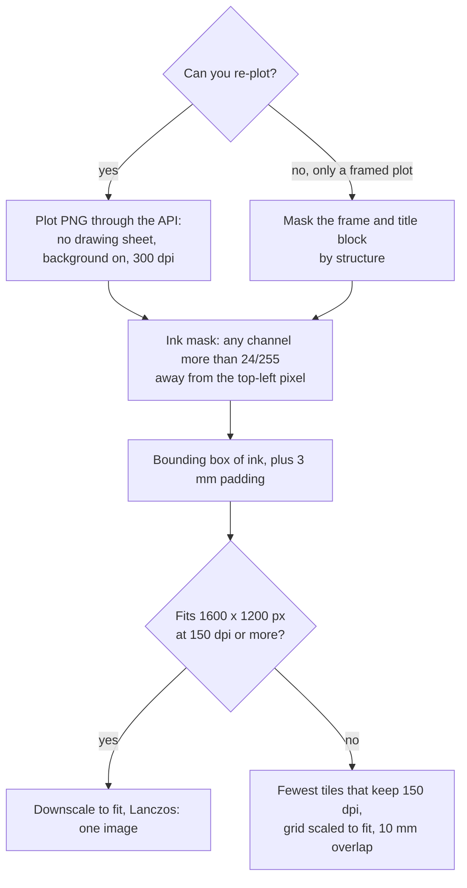

# Cropping schematic plots for display

Turning a KiCad schematic plot into an image showing the circuit at readable size in a terminal or chat view, without
page frame, title block, or empty paper.

Implementation: [`schematics/crop_plot.py`](../schematics/crop_plot.py) (Pillow), called by
`Schematic.plot_cropped()` in [`schematics/kicad_sch_ipc.py`](../schematics/kicad_sch_ipc.py). Every design built
with `kicad_sch_ipc.run()` writes `<name>_crop.png`, or tiles `<name>_crop_r<row>c<col>.png`.

## Problem

A plot covers the whole page. A small circuit on A4 fills a fraction of it, so text is a few pixels tall once a
viewer scales the page to its width; this session's image viewer shows at most about 1568 px across. Hand cropping
means guessing pixel offsets that change with page size, dpi, and layout.

## Heuristic



### 1. Plot without the drawing sheet (preferred)

`RunSchematicJobExportPng` with `plot_settings.plot_drawing_sheet = false`,
`plot_settings.sheet_mode = SJSM_SINGLE_SHEET`, `plot_background_color = true`, `dpi = 300`. The PNG still covers
the whole page, but its only ink is the drawing. Nothing to detect or mask, so this path is independent of the
drawing sheet.

The PNG has no resolution metadata. Track the requested dpi; padding and the legibility floor derive from it.

### 2. Ink mask and bounding box

- Background is the top-left pixel. With `plot_background_color = false` the PNG is transparent and the mask is the
  alpha channel.
- A pixel is ink when any RGB channel differs from the background by more than **24/255**, enough to drop faint
  anti-aliasing. Colours measured in a plot from this build: background `#F5F4EF`, wires `#21A320`, symbol
  outlines `#840000`, fields `#006464`, notes `#0000C2`. Faintest is the symbol body fill `#FFFFC2`, 45/255 from the
  background on blue, so still ink. A theme fill closer than 24/255 is fine if the body has an outline.
- `Image.getbbox()` on the mask gives the content box. Pad by **3 mm** (`3 / 25.4 × dpi` px), clamped to the page.

Hidden fields are not plotted, so never count as content.

### 3. Fit or tile

Target box **1600 × 1200 px**, about what a terminal image viewer shows without rescaling. Legibility floor
**150 dpi**. KiCad's default text is 1.27 mm: about 7.5 px at 150 dpi, about 15 px at 300 dpi.

`layout()` tries tile counts n = 1, 2, 3, … and, per factorisation n = nx × ny, the largest scale at which an
nx × ny grid of 1600 × 1200 tiles with 10 mm overlap covers the content (never upscaling past the plot's dpi). It
takes the smallest n reaching 150 dpi, and for that n the highest-dpi grid. Content is resampled once with Lanczos
and cut into evenly spaced, overlapping tiles.

Since each candidate grid is scaled to fit, an extra row or column appears only when legibility needs it, and every
tile is fully used. The first version used fixed 150 dpi tiles: a drawing a few millimetres too tall got a second
row repeating the first, shifted about 30 px, and the bit-line labels were cut at the top edge.

The 10 mm overlap means a symbol or label cut by one tile edge is whole in the neighbouring tile.

### 4. Fallback: plots that include the drawing sheet

For when re-plotting is impossible, e.g. a PNG you were handed. Finds frame and title block from image structure,
not page-size tables, then continues at step 2 with that region masked:

- **Row and column coverage** from a box-filter resize of the mask to 1 × h and w × 1 px. No per-pixel Python loop.
- **Inner border.** From each page edge, scan inward over the outer 12 % of the page for bands of rows (or columns)
  more than 80 % ink. The default sheet has two frames, outer and inner 2 mm further in, with the reference band
  between. Stop at the second band; the drawing starts just inside.

  Lines further in are drawing content however long. An earlier rule, "the line > 60 % ink nearest the
  page centre", mistook the 16-bit SRAM's word lines (82 % of page width) for the border and cropped the array
  to one row.
- **Title block.** Probe a strip next to the inner right border, 8 % of the inner width, which lies inside the
  110 mm title block even on A0. In the lower half, find rows more than 95 % ink. Accept a candidate, topmost first,
  only if its ink runs left to some x₀ and a vertical rule drops from x₀ to the bottom border (the title block's left
  edge). Mask the rectangle from (x₀, top) to the bottom-right corner.
- Padding reaching back into frame or title block is painted with the background colour.

Pass the plot's dpi: `crop_plot.py --framed --dpi 200 plot.png out.png`. KiCad PNGs carry no dpi; the CLI
otherwise assumes 300.

## Results

Four designs, all built through the IPC API with `schematics/*/build.py`. Each netlist matched its build script's
expectation; ERC reported 0 violations. Crop times are `crop()` alone, on this machine.

| Design | Page | Content (mm) | Output | Effective dpi | Crop time (ms) | Framed fallback bbox error (mm) |
|---|---|---|---|---|---|---|
| `ne555_blinker` | A5 | 86 × 62 | 1 image, 1091 × 805 | 300 | 15 | ≤ 0.1 |
| `buzzer` | A5 | 81 × 60 | 1 image, 1031 × 782 | 300 | 14 | ≤ 0.1 |
| `am_radio` | A4 | 154 × 82 | 1 image, 1600 × 886 | 255 | 71 | ≤ 0.1 |
| `sram16` (4 × 4 array of 6T cells, 96 MOSFETs) | A3 | 344 × 195 | 2 × 1 tiles, 1600 × 1200 each | 152 | 210 | ≤ 0.1 |

"Framed fallback bbox error" compares the fallback's content box on the framed 200 dpi sheet plot with the box from
a 300 dpi sheetless plot of the same file, both in mm.

`sram16` as its drawing grows taller:

| Extra height | Grid | Effective dpi |
|---|---|---|
| 0 mm | 2 × 1 | 152 |
| +5 mm | 2 × 2 | 226 |
| +40 mm | 2 × 2 | 226 |

Two tiles to four is a real step: two would need less than 150 dpi, and no three-tile grid is better (3 × 1 is still
height-limited). If two slightly smaller tiles are preferable, lower `MIN_DPI`; legibility, not tile count, is the
hard constraint.

## Limits

- **Custom drawing sheets.** Matter only for the framed fallback. A sheet without two outer frames, or with its title
  block not bottom-right, defeats structural detection; plot without the sheet instead.
- **Non-uniform backgrounds.** Placed bitmaps reaching the page edge, or a theme background differing from the
  top-left pixel, break the ink test.
- **Very large designs.** Produce many tiles. Plot hierarchical sheets one at a time (`plot_pages`,
  `SJSM_ALL_SHEETS`) rather than cramming one page.
- **Terminal-specific numbers.** 1600 × 1200 and 150 dpi are tuned for this session's viewer. Change `MAX_SIZE` and
  `MIN_DPI` in `crop_plot.py` for another viewer.

## Usage

```sh
# Part of a design build (writes <name>_crop.png or tiles next to the plots); runtime from engine/kicad-agent doctor
eval "$(python3 engine/kicad-agent env)"
"$KICAD_AGENT_PYTHON" schematics/<design>/build.py

# Standalone, on a PNG plotted without the drawing sheet at 300 dpi
python schematics/crop_plot.py --dpi 300 plot.png out.png

# Standalone, on a full-sheet plot
python schematics/crop_plot.py --framed --dpi 200 sheet.png out.png
```

With tiles, the CLI prints one path per tile, row by row.
